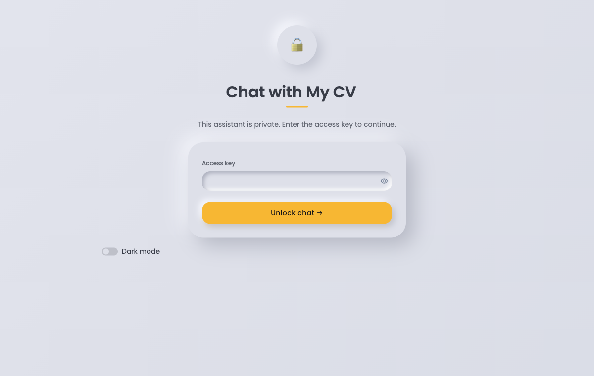
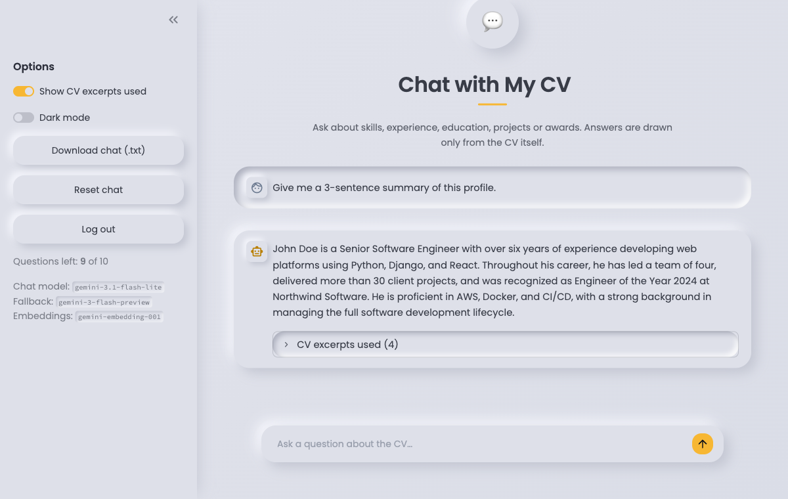

# Chat with My CV

A small Retrieval-Augmented Generation (RAG) app: visitors with an access key ask questions, and Google Gemini answers using only passages retrieved from your CV PDF.

**Live demo:** <https://cv-chatbot.streamlit.app/> (access key required, limited to 10 questions per session)

<table>
  <tr>
    <td align="center"><b>Access-key screen</b><br></td>
    <td align="center"><b>Chat with excerpts</b><br></td>
  </tr>
</table>

> Screenshots use the fictional demo CV (`sample_cv.pdf`).

```
cv.pdf → pypdf → section-aware chunks → Gemini embeddings (cached in memory)
question → embed → NumPy cosine similarity → top-k chunks → Gemini chat → answer + excerpts
```

| File | Purpose |
|---|---|
| `app.py` | Streamlit UI, access-key gate, chat loop |
| `rag.py` | PDF extraction, chunking, embeddings, retrieval, answer generation, error translation |
| `config.py` | Reads settings from environment / `.env` / Streamlit secrets |
| `tests/` | Offline tests (no API key needed) |

## Setup

Requires Python 3.10+.

```bash
python3 -m venv .venv
source .venv/bin/activate          # Windows: .venv\Scripts\activate
pip install -r requirements.txt
cp .env.example .env               # then edit .env
```

Put your CV at `cv.pdf` (or set `CV_PATH`). It must be a text-based PDF, not a scan.

### Configuration

| Variable | Required | Default | Notes |
|---|---|---|---|
| `GEMINI_API_KEY` | yes | | Create at <https://aistudio.google.com/apikey>. This is **not** the Google Cloud project ID. |
| `APP_ACCESS_KEY` | yes | | The password visitors type. Choose a long random value; it is unrelated to the Gemini key. |
| `EMBEDDING_MODEL` | no | `gemini-embedding-001` | Text embedding model |
| `CHAT_MODEL` | no | `gemini-3.1-flash-lite` | Check the **Test Gemini connection** button; model names change often |
| `CHAT_FALLBACK_MODEL` | no | `gemini-3-flash-preview` | Used automatically if the main chat model is overloaded (5xx after retries) or not found (404). Set empty to disable. Verify it is still available, since older Gemini models get retired |
| `CHUNK_SIZE` / `CHUNK_OVERLAP` | no | `700` / `120` | Characters |
| `TOP_K` / `MIN_SCORE` | no | `4` / `0.0` | Excerpts per question; similarity floor |
| `OLLAMA_MODEL` / `OLLAMA_URL` | no | off / `http://localhost:11434` | Answer with a local [Ollama](https://ollama.com) model instead of Gemini (`ollama pull <model>` first). Chat text stays on your machine; embeddings still use Gemini. Not practical on Streamlit Cloud's free tier |
| `MAX_QUESTIONS_PER_USER` | no | `10` | Questions allowed per browser session. A page refresh starts a new session (and a new quota); logging out does not reset it |
| `MAX_DAILY_QUESTIONS` | no | `200` | Global cap across all visitors per day (server local time). Resets at midnight and on restart |
| `SHOW_ADMIN_TOOLS` | no | off | Set `true` locally to show the **Test Gemini connection** button; leave off when public |

Generate an access key: `python -c "import secrets; print(secrets.token_urlsafe(24))"`

## Run

```bash
streamlit run app.py
```

Open the URL shown (usually <http://localhost:8501>), enter the access key, then (with `SHOW_ADMIN_TOOLS=true`) use **Test Gemini connection** in the sidebar once. It makes one real embedding request and one real chat request.

Run tests: `python -m pytest -q`

## Questions to try

- "Give me a 3-sentence summary of this profile."
- "Where did they work, and in which years?"
- "What are the main technical skills?"
- "What education do they have?"
- "Which awards have they received?"
- "Which migrations did they lead, and what were the results?"
- Absent from the CV (should say it isn't mentioned): "Do they have an AWS certification?" / "What is their salary expectation?"
- Follow-up: "And the job before that?"

## How the CV is processed

1. **Extract:** pypdf reads `cv.pdf`. A scanned, empty or corrupt PDF gives a clear error.
2. **Chunk:** the text is split on ALL-CAPS headings such as SUMMARY and EXPERIENCE. Any section longer than `CHUNK_SIZE` (700) characters is cut into overlapping windows of `CHUNK_OVERLAP` (120) characters. Each chunk starts with a label such as `[EXPERIENCE]`.
3. **Embed:** all chunks go to Gemini (`gemini-embedding-001`) in batched requests (up to 50 chunks each). Each chunk comes back as a vector, a list of numbers representing its meaning.
4. **Cache:** the chunks and vectors are held in memory with `st.cache_resource`. The cache is keyed on the PDF's modification time and the model and chunk settings, so questions never re-embed the CV. Editing the PDF rebuilds it, and restarting the server loses it.

### Measured on the sample CV

These figures come from running the pipeline on the CV this project was built and tested with, using the default settings (`CHUNK_SIZE=700`, `CHUNK_OVERLAP=120`, `TOP_K=4`). Your own CV will give different numbers.

| Measure | Value |
|---|---|
| Pages | 1 |
| Extracted text | 3,344 characters, 479 words |
| Sections detected | 10: HEADER, SUMMARY, EXPERIENCE, PROJECTS, INTERESTS, CONTACT, EDUCATION, LANGUAGES, SKILLS, AWARDS |
| Chunks | 12 (EXPERIENCE is long enough to split into 3; every other section is 1 chunk) |
| Chunk length | 34 to 712 characters, average about 302, 3,628 in total |
| Embedding vectors | 12 × 3,072 numbers, about 144 KB in memory |
| Embedding requests at build time | 1 (12 chunks fit in a single batch) |
| Chunks sent to the chat model per question | 4 of the 12 (`TOP_K`) |

The chunk total (3,628) is higher than the extracted text (3,344) because each chunk carries its section label and the long EXPERIENCE section is cut with overlap. A one-page CV is tiny for RAG: the whole index is 12 vectors, so NumPy cosine similarity over all of them is effectively instant and no vector database is needed.

Re-measure for your own CV with:

```bash
PYTHONPATH=. python -c "import rag; from config import load_settings as L; s=L(); t=rag.extract_text(s.cv_path); c=rag.chunk_text(t, s.chunk_size, s.chunk_overlap); print(len(t), len(c), [len(x.text) for x in c])"
```

## How it behaves

- **Sections:** text is split on ALL-CAPS headings (SUMMARY, EXPERIENCE, …). Long sections are split further with overlap. Each chunk is prefixed with its section name.
- **Grounding:** the system prompt forbids inventing facts, requires saying when the CV lacks the answer, and separates stated facts from interpretation. It cannot be a guarantee; check answers that matter.
- **Resilience:** transient Gemini 5xx errors are retried twice (1 s, 3 s). If the chat model is still failing, the answer is generated with `CHAT_FALLBACK_MODEL`. Quota and bad-key errors are not retried or failed over.
- **Cost control:** embeddings are built once per server process (`st.cache_resource`), keyed on the CV file's modification time and chunk/model settings. Each question costs one query embedding and one chat call.

### In-memory vs persistent embeddings

| | In-memory (current) | Saved to disk |
|---|---|---|
| Simplicity | none to manage | cache file and invalidation to manage |
| Cold start | re-embeds the CV (a few chunks, seconds, negligible cost) | instant |
| Staleness | rebuilt when the CV file changes | must key the cache on a hash of the PDF + settings |

For a one-page CV, in-memory is the right trade-off. Persist (an `.npy` file keyed by a PDF hash) only if the CV grows large or restarts become frequent. A vector database is unnecessary at this scale.

## Local LLM (Ollama)

By default answers come from Gemini. You can instead answer with a model running on your own machine, so the chat text never leaves it. Embeddings (retrieval) still use Gemini, so `GEMINI_API_KEY` is still required.

1. Install and start Ollama (macOS):
   ```
   brew install ollama
   brew services start ollama   # or run `ollama serve` in a terminal
   ```
2. Download a model (about 2 GB for `llama3.2`):
   ```
   ollama pull llama3.2
   ollama list                  # confirm it is there
   ```
3. Set it in `.env` and restart the app:
   ```
   OLLAMA_MODEL=llama3.2
   # OLLAMA_URL=http://localhost:11434   # only if Ollama runs elsewhere
   ```

Remove or comment out `OLLAMA_MODEL` to go back to Gemini. The first answer is slow while the model loads into memory.

Troubleshooting:
- `Cannot reach Ollama at ...`: Ollama is not installed or not running. Start it as above.
- `Ollama model '...' not found`: run `ollama pull <model>` with the exact name in `.env`.
- Not practical on Streamlit Community Cloud's free tier (no GPU, about 1 GB RAM); use it for local or self-hosted runs.

## Uploading a CV

Use **Upload a CV (PDF)** in the sidebar to chat with a different CV. It is indexed in memory for your session only (max 5 MB, text-based PDF), replaces the default CV until you clear it, and resets the chat. Its text is sent to Google for embeddings. Removing the file returns to the default CV.

## Security notes

- Secrets live only in `.env` or Streamlit secrets, never in code. `.env` is git-ignored. The Gemini key is only used server-side.
- The access key is compared in constant time. There is no failed-attempt lockout (a shared lockout let one visitor block everyone), so use a long random key, for example `secrets.token_urlsafe(24)`.
- **Your CV contains personal contact details.** Anyone with the access key can ask for them, and CV text is sent to Google's API. If you do not want that, remove them from the PDF.
- `*.pdf` is git-ignored so the CV is not pushed by accident.

## Deploy to Streamlit Community Cloud

1. Create a GitHub repository and push this project. The repo ships with `sample_cv.pdf`, a fictional demo CV (John Doe), which is the only PDF `.gitignore` lets through. Your real `cv.pdf` stays ignored, so it is never committed.
2. At <https://share.streamlit.io>, choose **Create app** and fill the form:
   - **Repository:** `your-github-user/your-repo`
   - **Branch:** `main`
   - **Main file path:** `app.py`
3. Under **Advanced settings → Secrets**, paste:
   ```toml
   GEMINI_API_KEY = "your_gemini_api_key"
   APP_ACCESS_KEY = "your_private_app_access_key"
   CV_PATH = "sample_cv.pdf"
   ```
   To serve a real CV instead, use a **private** repo, remove `*.pdf` from `.gitignore` (or `git add -f cv.pdf`) and set `CV_PATH = "cv.pdf"`. Never put a real CV in a public repo.
4. Deploy. Streamlit installs `requirements.txt` automatically. Set the app's sharing to restrict who can open the URL if you want a second layer on top of the access key.

Free-tier Gemini keys have rate and daily limits; if visitors see "rate limit or quota reached", wait or enable billing for the project.

## Troubleshooting

| Message | Fix |
|---|---|
| Missing configuration: GEMINI_API_KEY… | Create `.env` from `.env.example` and restart Streamlit |
| The Gemini API key was rejected | Re-create the key in AI Studio; make sure it is not the project ID; no quotes or spaces in `.env` |
| Model not found or unsupported | Change `CHAT_MODEL` / `EMBEDDING_MODEL` to a model listed in AI Studio's docs |
| Rate limit or quota reached | Wait a minute, lower usage, or enable billing |
| Could not reach the Gemini API | Check your internet connection or proxy |
| No text could be extracted | The PDF is a scan or image; export a text PDF or OCR it |
| CV file not found | Put the PDF at `cv.pdf` or set `CV_PATH` |
| Answers feel off | Raise `TOP_K`, or reduce `CHUNK_SIZE` for more precise excerpts |
